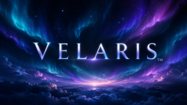

# Velaris

<p align="center">
  
  &nbsp;&nbsp;&nbsp;
  
</p>

Gemeinsames Repository für Velaris auf iOS, Android, Android TV / Google TV und als installierbare iPhone-Web-App.

## Stand der Zusammenführung

Die vollständigen Quellstände beider Apps wurden übernommen. Aktuell sind es zwei separat baubare Anwendungen in einem Repository. Gemeinsame Anwendungslogik und eine einheitliche, geräteangepasste Oberfläche sind der nächste Schritt; dieser Import stellt noch keine gemeinsame Runtime her.

| Bereich | Pfad | Technik |
| --- | --- | --- |
| Smartphone (iOS / Android) | [apps/mobile](apps/mobile) | React Native / Expo / TypeScript |
| Web (iPhone / Desktop PWA) | [apps/web](apps/web) | HTML / CSS / JavaScript / Jellyfin API |\n| TV (Android TV / Google TV) | [apps/tv](apps/tv) | Kotlin / Media3 |
| Importnachweis und nächste Schritte | [docs/MIGRATION.md](docs/MIGRATION.md) | Quellstände, Umfang und Einschränkungen |

## Smartphone starten

Node.js 22.13+ verwenden. Alle Expo- und EAS-Befehle aus `apps/mobile` ausführen:

```bash
cd apps/mobile
npm ci
npm run start
```

Typprüfung: `npm run typecheck`.
Android-Test-APK über EAS: `npx eas-cli build --platform android --profile preview`.
Die vorhandene Expo-Projektzuordnung bleibt bestehen; dafür ist Zugriff auf das bestehende Expo-Projekt erforderlich.

## iPhone-Web-App (PWA)\n\nDie neue [Velaris Web-App](apps/web/README.md) kann auf ZimaOS per Docker und im privaten Tailnet via Tailscale Serve (HTTPS) betrieben werden. Danach über Safari zum iPhone-Home-Bildschirm hinzufügen. Ein Apple-Developer-Account oder eine kostenpflichtige Domain ist nicht nötig. Für die Jellyfin-Verbindung sind HTTPS und korrektes CORS bzw. ein Reverse Proxy erforderlich. Web-App MVP, noch nicht auf iPhone und ZimaOS validiert.\n\n## Velaris TV 1.0.0 (UI-Polish-Pass 10)

Die native Android-TV-App in `apps/tv` ist auf **Version 1.0.0** (`versionCode 8`) gesetzt. Sie besitzt weiter dieselbe Android-Anwendungs-ID `com.novarion.velaristv`; die Smartphone-App bleibt unabhängig versioniert.

Release-Härtung und Abnahmetests: [UI-Pass 10](docs/UI_POLISH_PASS_10.md). Eine offizielle Veröffentlichung setzt grüne CI-Läufe, eine auf dem Google TV getestete APK und die Signierung mit dem passenden Schlüssel voraus.

## TV bauen

In Android Studio den Ordner `apps/tv` öffnen oder mit JDK 17 und Gradle 9.6.0:

```bash
cd apps/tv
gradle :app:lintDebug :app:assembleDebug
```

APK: `apps/tv/app/build/outputs/apk/debug/app-debug.apk`.

## GitHub Actions

Die aktiven Workflows liegen zentral in `.github/workflows`:

- **Android TV CI**: TV-Lint und Debug-APK bei TV-Änderungen oder manuell.
- **Build unsigned iOS IPA**: manueller Build; die IPA ist unsigniert und muss vor einer Geräteinstallation signiert werden.
- **Generate package-lock**: manuelle Aktualisierung des Smartphone-Lockfiles.

Arbeitsverzeichnisse, npm-Cache und Artefaktpfade sind an die neue Struktur angepasst. Ein lokaler Android-Smartphone-Workflow war im Ursprungsrepository nicht vorhanden; dafür bestehen die EAS-Buildprofile.

## App-Identität

- Smartphone Android / iOS: `at.velaris.app`
- Android TV: `com.novarion.velaristv`
- Bestehende Versionen, Icons, Avatare und EAS-Projekt-ID bleiben erhalten.
- Signierschlüssel, GitHub-Secrets, Expo-Zugriffsrechte und frühere Build-Artefakte sind keine Quelldateien und werden durch diesen Import nicht übertragen. Die bestehende Signierung ist für Updates vorhandener Installationen erforderlich.

Die README-Dateien in den App-Ordnern dokumentieren den übernommenen Stand; ihre früheren Fertigmeldungen sind keine erneute Gerätevalidierung.

## Gemeinsame Struktur und Designsystem (Unified Experience)

```text
Velaris/
├── apps/mobile/               # iOS + Android (Expo / React Native)
├── apps/web/                  # installierbare iPhone-PWA und Web-Player\n├── apps/tv/                   # Android TV / Google TV (Kotlin / Media3)
├── packages/velaris-design/   # einheitliche Farben, Navigation, Profile und Reihen
├── assets/                    # zentrale App-Icons, Banner, Avatare
└── scripts/                   # Asset-Synchronisation und Konsistenztests
```

**Wichtig:** Alle Geräte nutzen dieselben Designvorgaben und echten Jellyfin-Konten.
Die mobile und die TV-Oberfläche sind gerätegerecht ausgelegt: Touch-Bedienung,
Cast und Downloads auf Smartphones, D-Pad-Navigation und Media3 auf dem TV.
Es gibt bewusst noch zwei native UI-Runtimes; der gemeinsame Brand-Vertrag liegt
in [packages/velaris-design/brand.json](packages/velaris-design/brand.json).

### Assets vereinheitlichen

Neue/ersetzte Bilder in `assets/` ablegen, danach im Repo-Stamm ausführen:

```bash
node scripts/sync-assets.cjs
node scripts/check-unified.cjs
```

Bei Änderungen auf GitHub ohne lokales Checkout müssen die App-Kopien
ebenfalls mit aktualisiert werden. Die CI meldet Abweichungen.

### Profile und Synchronisation

- Auf Handy und TV bis zu **5 echte Jellyfin-Benutzerkonten** (lokale Anmeldungen).
- Profilwahl beim Start; Favoriten, Verlauf und Weiterschauen kommen je Benutzer
  aus Jellyfin und sind damit geräteübergreifend synchronisiert.
- Vorhandene TV-Scheinprofile ohne Jellyfin-Anmeldung können keinen eigenen
  Fortschritt besitzen. Beim Umstieg bleibt das authentifizierte Konto erhalten;
  weitere Personen müssen sich mit eigenen Jellyfin-Konten anmelden.
- Geräte-eigene Einstellungen, heruntergeladene Medien und lokal gewählte
  Profilbilder werden **nicht** über Jellyfin synchronisiert.

GitHub Actions prüfen die gemeinsame Gestaltung und die mobile Typprüfung;
die separate TV-CI führt Lint und den APK-Build aus. Gerätespezifische
Funktionstests sind weiterhin notwendig.
