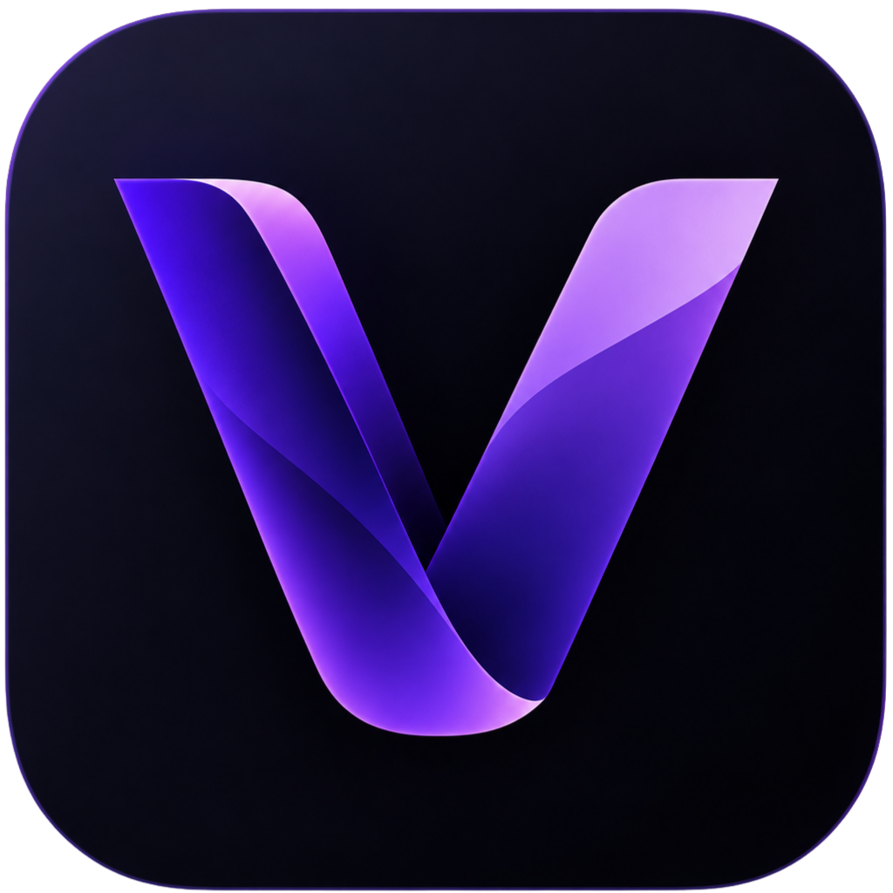
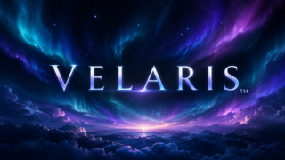

# Velaris

<p align="center">
  
  &nbsp;&nbsp;&nbsp;
  
</p>

Gemeinsames Repository für Velaris auf iOS, Android, Android TV / Google TV und als installierbare Web-App (PWA). Jellyfin dient als Medienserver; die Plattformen werden unabhängig versioniert.

## Stand der Zusammenführung

Die mobilen, TV- und Web-Anwendungen liegen in einem Monorepo, bleiben aber eigenständig baubar und versioniert. Gemeinsame Designvorgaben liegen unter `packages/velaris-design/`; es gibt derzeit keine einheitliche Runtime.

| Bereich | Pfad | Technik |
| --- | --- | --- |
| Smartphone (iOS / Android) | [apps/mobile](apps/mobile) | React Native / Expo / TypeScript |
| Web (iPhone / Desktop PWA) | [apps/web](apps/web) | HTML / CSS / JavaScript / Jellyfin API |
| TV (Android TV / Google TV) | [apps/tv](apps/tv) | Kotlin / Media3 |
| Importnachweis und nächste Schritte | [docs/MIGRATION.md](docs/MIGRATION.md) | Quellstände, Umfang und Einschränkungen |

## Plattformversionen

| Plattform | Versionsstand im Quellcode |
| --- | --- |
| Velaris TV | **2.2.1** (`versionCode` 11) – Design-Synchronisierung |
| Velaris Smartphone | **2.2.1** (Expo, Android `versionCode` 11) – Design-Synchronisierung |
| Velaris Web und iPhone-PWA | **3.0.0 Stable** (gemeinsamer Web/PWA-Release vom 26.11.2026) |

**Layout-Familien:** Smartphone-App und iPhone-PWA nutzen das Mobile Design mit vier Bottom-Tabs und einer eigenen Kategorienauswahl. Desktop-Web und Android TV nutzen das TV/Desktop Design mit horizontaler Kategorienavigation. Der gemeinsame Vertrag liegt in [`brand.json`](packages/velaris-design/brand.json). Die [Design-Synchronisierung 2.2.1](docs/DESIGN_SYNC_2_2_1.md) dokumentiert den historischen Ausgangsstand vor dem neuen Mobile-Navigationspass. Pixelgenaue Gerätevergleiche, native Builds und ein erneutes PWA-Deployment stehen noch aus.

Die Versionsnummern sind unabhängig von einem signierten oder ausgerollten Release. Mobile benötigt einen neuen EAS-Build, Web ein neues Deployment und TV eine signierte APK für produktive Updates.

**Web/PWA Stable 3.0.0:** iPhone-PWA-Wiedergabe und Chromecast wurden nach den Fixes auf der ZimaOS-Installation bestätigt. Siehe die [Release Notes](apps/web/RELEASE_3.0.0.md). Diese Versionsvergabe betrifft **nur** `apps/web`; TV und native Smartphone-App bleiben bei ihren eigenen Versionen.

## Design – zwei Layout-Familien

Velaris verwendet eine einheitliche Markenidentität, aber zwei für ihre Geräte optimierte Layouts. **Smartphone und iPhone-PWA** sind das mobile Paar, **Android TV und Desktop-Web** das TV/Desktop-Paar. Die Akzentfarben sind in [`packages/velaris-design/brand.json`](packages/velaris-design/brand.json) definiert. Die drei Apps besitzen derzeit eigenständige Oberflächenimplementierungen; gleiche Designtokens bedeuten nicht automatisch pixelgenaue Gleichheit.

### Design A – Smartphone / iPhone-PWA

**Plattformen:** Native Android-/iOS-Smartphone-App (`apps/mobile`) und mobile/iPhone-PWA (`apps/web` auf kleinen Viewports).

**Navigation und Layout (im Quellcode umgesetzt):**

- **Vier Bottom-Tabs:** `Start`, `Kategorien`, `Meine Liste` und `Profil`. Die Tab-Leiste soll inklusive iPhone-Home-Indikator und Android-Safe-Areas sichtbar bleiben.
- **Kategorien statt überfüllter Tab-Leiste:** Eigene, scrollbar bedienbare Kategorieauswahl in einem zweispaltigen Raster. In der PWA wird sie als modales Overlay über dem aktuellen Inhalt geöffnet; in Expo gibt es eine eigene Kategorienansicht über den Bottom-Tab sowie einen modalen Kategorienaufruf im Header.
- **Kategorie-Header:** Der *gesamte* Schriftzug `VELARIS` beziehungsweise `VELARIS FILME`, `VELARIS SERIEN`, `VELARIS ANIME` usw. erhält die Farbe der aktuellen Kategorie; **VELARIS wird nicht weiß abgesetzt**. Der bestehende kräftige Schriftstil bleibt erhalten, lange Titel müssen auch auf schmalen Geräten ohne Kollision mit Suche/Profil passen.
- **Inhalte:** Dunkle Grundfläche (`#08080D`), linksbündiger Hero mit Aktionen, horizontale Medienreihen und Poster im Verhältnis 2:3.
- **Verhalten:** Kategorieauswahl muss ohne Scrollen zum Seitenende erreichbar sein. Keine horizontalen Überschneidungen, abgeschnittenen Aktionen oder von der Tab-Leiste verdeckten Inhalte. Die Jellyfin-, Player- und Cast-Funktionen bleiben unabhängig von der optischen Navigation.

**Kategorien:** Startseite, Filme, Serien, Anime, Anime Filme/Anime Movies, Animation, Cartoons, Meine Liste und Sammlungen. Die YouTube-Akzentfarbe ist vorhanden; der funktionsfähige Umfang unterscheidet sich noch je Plattform und wird nicht als gemeinsame Fertigstellung ausgewiesen.

**Status:** Navigations- und Header-Änderungen im Repository eingetragen; Expo-Typecheck, reale Android-/iPhone-Tests und PWA-Deployment sowie visuelle Abnahme stehen noch aus. Die Versionsnummern wurden durch diesen Layoutschritt nicht automatisch erhöht.

### iPhone-PWA Chromecast – Wiedergabediagnose (16.11.2026)

Die iPhone-PWA verwendet die **ZimaOS Cast Bridge** (kein auf iOS nicht unterstütztes Google Cast Web Sender SDK). Dass Chromecast-Geräte gefunden werden, beweist noch nicht, dass der Fernseher die Jellyfin-Stream-URL erreichen und abspielen kann.

**Verbessert:** Der Cast-Server prüft vor dem Start `JELLYFIN_CAST_URL/System/Info/Public` und meldet eine falsch konfigurierte oder unerreichbare Jellyfin-LAN-Adresse verständlich. Der PWA-Dialog unterscheidet nun zwischen einem lediglich gesendeten Startbefehl und den Chromecast-Statuswerten `PLAYING`, `PAUSED`, `BUFFERING`, `IDLE` bzw. `idleReason`. Fehler im Receiver werden dadurch sichtbar. Das Cast-Dialog-Skript hat eine neue Asset-Version und der Service Worker einen neuen Cache.

**ZimaOS-Deployment:**

```bash
cd ~/AppData/Velaris
git pull origin main
cd apps/web
sudo docker compose up -d --build
sudo docker compose ps
sudo docker logs --tail 50 velaris-cast-bridge
```

**Chromecast-LAN-Adresse prüfen (kein Jellyfin-Token nötig):**

```bash
curl -i --max-time 8 http://192.168.0.74:8097/System/Info/Public
```

`192.168.0.74` ist aktuell lediglich der **Standardwert**. Ist die wirkliche ZimaOS-/Jellyfin-LAN-Adresse anders, in `apps/web/.env` z. B. `JELLYFIN_CAST_URL=http://<ZIMAOS-LAN-IP>:8097` eintragen. Der Chromecast selbst muss die angegebene Adresse erreichen können. Tailscale-Verbindungen auf dem iPhone werden nicht automatisch auf den Chromecast übertragen. Nicht den Jellyfin-API-Schlüssel, Transcoding-URLs oder Tokens aus Logs veröffentlichen.

**Status:** Die Änderungen verbessern Prüfung und Fehlerrückmeldung; ein erfolgreicher Filmstart auf einem echten Chromecast ist noch **nicht bestätigt**. Bei einem fortbestehenden Fehler bitte die exakte Meldung im Cast-Dialog und die Cast-Bridge-Logs **ohne Tokens** auswerten. Danach lassen sich Jellyfin-Transcoding, HLS-Codec, Firewall oder Chromecast-Erreichbarkeit gezielt prüfen.

### TV/Web UI-Pass 6 – Responsive Polish und Qualitätsprüfung

**Quellcode-Pass am 16.11.2026 umgesetzt, Geräteabnahme weiterhin offen.** Folgende Probleme wurden gezielt korrigiert:

- **TV-Fokus:** Ein fokussiertes Poster darf seine Position in der D-Pad-Navigationsreihenfolge nicht ändern. Die frühere Änderung der Kind-Ansichtsreihenfolge beim Fokus wurde entfernt; die Hervorhebung erfolgt weiter über Skalierung, Fokusrahmen und Z-/Elevationseffekt.
- **TV-Poster:** Die Breite bleibt an die verfügbare Bildschirmbreite gekoppelt; normale Reihen sind für vier komplett sichtbare Poster bei typischen TV-Viewport-Größen ausgelegt. Bei ungewöhnlich kleinen Viewports ist die reale Abnahme weiterhin notwendig.
- **Desktop-Navigation:** Die ausgewählte Kategorie wird beim Ansichtswechsel automatisch in den sichtbaren Bereich der horizontalen Navigation gebracht.
- **Responsives Web:** Kleinere Desktop-Fenster erhalten kompaktere Header-Abstände. Bei geringer Fensterhöhe werden Hero und Details angepasst, um Aktionen und weitere Reihen besser erreichbar zu halten.
- **Fokus/Safe-Areas:** Scrolleisten und Poster erhalten klarere Fokus-Zustände; reduzierte Bewegung wird berücksichtigt. Die Smartphone- und iPhone-PWA-Ansichten bleiben von den Desktop-Regeln getrennt.
- **Regressionstest:** `scripts/check-unified.cjs` wurde auf die aktuelle Vier-Tab-Mobile-Navigation aktualisiert und prüft jetzt zentrale TV/Web-Verträge für Navigation, vier Cover, Weiterschauen, Detailansichten und Asset-Versionierung.
- **PWA-Cache:** HTML-Asset-Versionen und Service-Worker-Cachekennung erhöht, um veraltete Desktop-CSS-/JS-Dateien nach einem Deployment abzulösen.

**Lokale automatisierte Prüfung nach dem Pull:**

```bash
node --check apps/web/main.js
node --check scripts/check-unified.cjs
node scripts/check-unified.cjs
```

**TV-Build (JDK 17, passendes Android SDK und Gradle erforderlich):**

```bash
cd apps/tv
gradle :app:lintDebug :app:assembleDebug
```

**Abnahmematrix – noch auf echten Geräten / in Browsern durchzuführen:**

| Plattform | Prüfansicht | Erwartung |
| --- | --- | --- |
| Google TV 1080p | Startseite / normale Medienreihe | 4 vollständig sichtbare Poster, kein Abschneiden am rechten Rand |
| Google TV 1080p | Header und D-Pad | Aktive Kategorie erreichbar, sichtbarer Fokus, kein Fokus-Sprung |
| Google TV 4K | Hero / Top 10 / Weiterschauen | Saubere Abstände, große Cover und korrektes 16:9-Format |
| Desktop-Web 1920 × 1080 | Startseite | 4 normale Poster, einzeiliger Header, Hero und Reihen ohne Überdeckung |
| Desktop-Web 1280 × 720 | Header / Hero / Details | Scrollbare Kategorien und vollständig erreichbare Aktionen |
| Desktop-Web 1024 × 768 | Kategorie / Episoden | 3 normale Poster, gut lesbare Staffel-/Episodenkarten |
| iPhone-PWA / Smartphone | Startseite / Kategorien | Mobile Navigation und Layout durch Desktop-Änderungen unverändert |
| TV und Web | Film / Episode / Fortsetzen | Wiedergabestart, Fortschritt und Staffelwechsel funktionieren |
| Desktop-Web | Cast-Fenster | Separates Overlay, aufrufbar und ohne Scroll-zum-Seitenende-Probleme |

**Freigabestatus: NICHT gerätegetestet / kein Release.** Quelltext- und Vertragsprüfungen ersetzen keine Bildschirmfotos oder einen echten TV-/Player-Test. Eine produktive Freigabe darf erst nach erfolgreichen Builds, Browser- und Gerätetests erfolgen.

### TV/Web UI-Pass 5 – Detailseiten und Weiterschauen (Quellcode)

**Umgesetzt am 16.11.2026:** Die TV-Seriendetails verwenden nun eine 500 dp hohe Hero-Fläche, einen größeren Titel und 270 × 152 dp breite Episodenbilder mit besser lesbaren Texten. Bei einer bereits begonnenen Folge erscheint am TV der Aktionsname **Fortsetzen**; die Wiedergabe selbst wurde nicht verändert. Die TV-Weiterschauen-Karten bleiben im 16:9-Format und besitzen besser lesbare Titel. Desktop-Web zeigt in der Startseitenreihe **Weiterschauen** nun eigenständige 16:9-Karten mit Play-Symbol, Titel, Episoden-/Restzeitangabe und Fortschrittsleiste; die mobile PWA behält ihre bisherigen Karten. Desktop-Detailseiten erhalten eine 500-Pixel-Herofläche, abgestimmte Typografie, größere Buttons sowie übersichtlichere Staffel- und Episodenkarten.

**Unverändert:** Jellyfin-Anfragen, Player, Fortsetzungslogik, Favoriten und Chromecast/Cast Bridge. Die Mobile-PWA-Navigation und mobile Detailgrößen bleiben bestehen; fehlende Funktionen werden nicht als umgesetzt dargestellt.

**Prüfstatus:** Quellcode eingetragen. Kotlin-Build, Desktop-Browser, echter Google TV, Safari-PWA sowie Staffelwechsel und Wiedergabestart sind noch zu testen. Danach folgt UI-Pass 6 (Responsive Polish und Geräteabnahme).

### TV/Web UI-Pass 4 – Poster-Fokus und Animationen (Quellcode)

**Umgesetzt am 16.11.2026:** TV und Desktop-Web verwenden für fokussierte bzw. per Maus hervorgehobene Poster eine dezente Skalierung um 3,5 %. Die TV-Karten behalten ihre D-Pad-Bedienung; der Fokusrahmen ist nun 3 dp breit und erhält die Kategorienfarbe. Die Karte wird beim Fokus nach vorne gehoben, damit benachbarte Cover den Effekt nicht überdecken. Desktop-Web erhält denselben farbigen Fokusrahmen, eine sanfte Animation sowie ein direkt im Poster eingeblendetes Band mit Medientyp und Erscheinungsjahr, sofern verfügbar. Die vier großen Poster aus Pass 1 bleiben erhalten. Animationen berücksichtigen die vorhandene TV-Einstellung und im Web `prefers-reduced-motion`.

**Unverändert:** Mobile PWA-Navigation und ihre Hover-/Focus-Skalierung, Player, Cast und Jellyfin. Die Schnellvorschau per Long-Press/Rechtsklick wird nicht ersetzt.

**Prüfstatus:** Quellcode eingetragen; TV-Build, Tastatur-/D-Pad-Test und Sichtprüfung auf realen Geräten ausständig. Als nächstes folgt UI-Pass 5 (Detailseiten und Weiterschauen).

### TV/Web UI-Pass 3 – Hero-Banner (Quellcode)

**Umgesetzt am 16.11.2026:** Der Desktop-Web-Hero orientiert sich nun am 515-dp hohen TV-Hero (Desktop: 515 CSS-Pixel), mit links unten ausgerichtetem Inhalt, abgestimmten dunklen Verlaufsflächen, einer klaren Text-Hierarchie, bis zu drei Zeilen Beschreibung und großflächigen Abspiel-/Detailaktionen. Jahr, Bewertung/Medientyp und bis zu drei Genres werden im Web wie bisher am TV angezeigt, sofern Jellyfin diese Metadaten liefert. Die Highlight-Indikatoren stehen unten rechts. Der TV-Hero behält seine drei Aktionen einschließlich `Meine Liste`, die bestehende Crossfade-Funktion und seine D-Pad-Bedienung; Innenabstände, Logogröße und Indikatoren wurden angeglichen. Die vier großen Posterreihen aus Pass 1 bleiben erhalten.

**Nicht verändert:** Mobile PWA Hero-Abmessungen, Jellyfin-API, Video-Player, Cast, Favoritenlogik, Hero-Klickbehandlung und automatische Highlight-Rotation. TV/Web besitzen eigene Rendertechniken; die Werte entsprechen einer optischen Zielvorgabe, nicht einer Garantie identischer Pixelgrößen.

**Prüfstatus:** Quellcode integriert; visuelle Abnahme auf Google TV und Desktop-Web sowie Kotlin-/Browser-Tests stehen noch aus. Anschließend folgt UI-Pass 4 (Fokus und Animationen).

### TV/Web UI-Pass 2 – Header und Kategorienavigation (Quellcode)

**Umgesetzt am 16.11.2026:** Desktop-Web integriert nun den VELARIS-Schriftzug, die horizontal scrollbare Kategoriennavigation und die Aktionen in **einer gemeinsamen Kopfzeile**, passend zur TV-Struktur. Die Kategorien behalten ihre bestehende Reihenfolge und individuelle Akzentfarbe; der gesamte Bereichsschriftzug hat dieselbe Kategorie-Akzentfarbe. Der aktive Navigationspunkt erhält eine farbige Pill-Fläche. TV verwendet keinen Weiß-Akzent-Verlauf mehr im Bereichsschriftzug, reduziert den Abstand zwischen Navigationselementen und scrollt bei Seitenwechsel zur aktiven Kategorie. Profil und Einstellungen bleiben auf dem TV auch außerhalb der Startseite erreichbar.

**Unverändert:** Mobile PWA (vier Bottom-Tabs und Kategorien-Overlay), alle Player-/Cast-/Jellyfin-Funktionen sowie die Funktionalität der TV-Medienansichten. Die bisherige YouTube-Unterstützung ist je Plattform unterschiedlich; kein funktionierender TV-YouTube-Reiter wurde ergänzt.

**Prüfstatus:** Quellcode eingetragen; echte TV-/Browser-Tests auf 1080p, 4K, kleineren Desktopfenstern und D-Pad-Fokus noch offen. Die Scroll-Leiste und der Header müssen dabei auf abgeschnittene Texte und Fokusränder überprüft werden. Als nächstes folgt UI-Pass 3 (Hero).

### TV/Web UI-Pass 1 – Postergrößen und Medienreihen (Quellcode)

**Umgesetzt am 16.11.2026:** Die normalen TV-Startseitenreihen berechnen ihre Posterbreite aus der aktuellen verfügbaren Bildschirmbreite und zielen auf vier vollständig sichtbare Cover im Verhältnis 2:3. Titel stehen lesbar unter dem Poster; Abstände und Fokuseffekte bleiben berücksichtigt. Desktop-Web verwendet bei mindestens 1200 CSS-Pixel Fensterbreite vier Poster pro normaler Startseitenreihe, von 850 bis 1199 CSS-Pixeln drei. Für schmalere Ansichten gilt unverändert das mobile Design. Top 10, Weiterschauen, Bibliotheksraster und Player bleiben eigenständig.

**Abnahme offen:** TV-Lint/Build, reales Google-TV-Verhalten und Browser-Screenshots. Die Größenauslegung wird erst nach echten Gerätevergleichen final bestätigt. TV/Desktop-Header, Hero, Fokus-Polish und Detailseiten folgen in separaten Pässen; keine Änderungen an Jellyfin-/Player-/Cast-Logik.

### Design B – Android TV / Desktop-Web

**Plattformen:** Native Android-TV-/Google-TV-App (`apps/tv`) und Desktop-Ansicht der Web-App (`apps/web`).

**Bisherige Basis:** Dunkles Velaris-Theme, gemeinsame Kategorie-Akzentfarben, große Hero-Fläche, Medienreihen und horizontale Kategorienavigation. Eine vollständige visuelle Parität ist noch **nicht** bestätigt: Der TV-Header integriert die Navigation derzeit anders als der Desktop-Web-Header.

**NÄCHSTER DESIGNSCHRITT – TV/Web-Angleichung:**

1. **Header & Navigation:** Identische Reihenfolge, Abstände und visuelle Hierarchie für `Start`, `Filme`, `Serien`, `Anime`, `Anime Filme`, `Animation`, `Cartoons`, `Meine Liste`, `Sammlungen` und – nur wo funktional vorhanden – `YouTube`. Auch bei kleineren Desktop- und TV-Auflösungen dürfen Elemente nicht abgeschnitten werden.
2. **Branding:** `VELARIS` bzw. `VELARIS <KATEGORIE>` vollständig in der jeweiligen Akzentfarbe, mit identischer Typografie, Schriftgröße und Akzentführung. Grundfläche bleibt dunkel.
3. **Hero & Startseite:** Bildausschnitt, Titelposition, Buttons, Indikatoren, Abstände und Übergänge so weit wie möglich vereinheitlichen; unterschiedliche Bildschirmformate responsiv behandeln.
4. **Posterreihen & Detailseiten:** Einheitliche Posterproportionen (2:3), Kartenabstände, Zeilenhöhen, Fortschrittsanzeigen, Detailaktionen und Episoden-/Staffelansichten.
5. **Plattformgerechte Bedienung:** TV benötigt sichtbare, nicht abgeschnittene D-Pad-Fokusrahmen und Fernbedienungsnavigation; Web benötigt sinnvolle Maus-, Hover- und Tastaturzustände. Visuelle Gleichheit darf die jeweilige Bedienbarkeit nicht verschlechtern.
6. **Abnahme:** Desktop-Web und Google TV anhand gleicher Testansichten/Screenshots vergleichen; vorhandenen Player, Cast und Jellyfin-Funktionen mit Regressionstests absichern. Erst danach den Pass als abgeschlossen markieren.

**Status:** UI-Pass 1 (Postergrößen) im Quellcode umgesetzt, aber noch nicht getestet oder deployed. UI-Pass 2 (Header und Navigation) ebenfalls im Quellcode umgesetzt; UI-Pass 3 (Hero-Banner) ebenfalls im Quellcode umgesetzt; UI-Pass 4 (Fokus/Animationen) ebenfalls im Quellcode umgesetzt; UI-Pass 5 (Detailseiten und Weiterschauen) und der Quellcode-Teil von UI-Pass 6 (Responsive Polish/Regressionstests) sind umgesetzt. **Offen bleibt die praktische Abnahme auf Google TV, Desktop-Web und iPhone-PWA; keine Release-Freigabe.**

### Gemeinsame Designregeln und Farben

Alle Plattformen nutzen den Grundhintergrund `#08080D`. Der aktive Kategoriename, der gesamte Velaris-Bereichsschriftzug sowie passende Fokus-, Auswahl- und Fortschrittsakzente übernehmen die jeweilige Farbe:

| Bereich | Hex | Bereichsschriftzug |
| --- | --- | --- |
| Startseite | `#7C5CFC` | VELARIS |
| Filme | `#46D369` | VELARIS FILME |
| Serien | `#7DD3FC` | VELARIS SERIEN |
| Anime | `#FF8A00` | VELARIS ANIME |
| Anime Filme / Anime Movies | `#FFD43B` | VELARIS ANIME FILME |
| Animation | `#FF6FAE` | VELARIS ANIMATION |
| Cartoons | `#00D9C0` | VELARIS CARTOONS |
| Meine Liste | `#E8A0FF` | VELARIS MEINE LISTE |
| Sammlungen | `#D9A86C` | VELARIS SAMMLUNGEN |
| YouTube (plattformabhängig / vorbereitet) | `#FF0033` | VELARIS YOUTUBE |

Weitere mögliche Kategorien wie Dokumentationen, Musik, Live TV, Podcasts, Hörbücher oder Kurzfilme sind **nur Ideen für später** und gehören aktuell weder zur Navigation noch zu einem beauftragten Implementierungsschritt.

**Wichtig:** Ein Quellcode-Commit ist kein Gerätetest und kein automatisches Deployment. Designänderungen müssen auf den jeweiligen Plattformen separat geprüft werden.

## Smartphone starten

Node.js 22.13+ verwenden. Alle Expo- und EAS-Befehle aus `apps/mobile` ausführen:

```bash
cd apps/mobile
npm ci
npm run start
```

Typprüfung: `npm run typecheck`.
Android-Test-APK über EAS: `npx eas-cli build --platform android --profile preview`.
Die vorhandene Expo-Projektzuordnung bleibt bestehen; dafür ist Zugriff auf das bestehende Expo-Projekt erforderlich.

## Velaris Web (PWA)

Die [Web-App](apps/web/README.md) läuft über Docker/Nginx auf ZimaOS und kann via Tailscale Serve im privaten Tailnet per HTTPS erreicht werden. iOS-Nutzer können sie in Safari zum Home-Bildschirm hinzufügen. Die tatsächliche Wiedergabe hängt von HTTPS, Jellyfin-Erreichbarkeit, Browser-Codecs und Transcoding ab. Versionsangaben oben sind Quellcode-Stände, keine Bestätigung für ein ausgerolltes Deployment.

## Velaris als ZimaOS-App

Für die App-Kachel mit Start/Stopp/Neustart in ZimaOS liegt eine eigene
[`x-casaos`-App-Definition](zimaos/velaris-compose.yaml) vor.
Die [Installations- und Migrationsanleitung](zimaos/README.md) erklärt, wie die
bestehende Web-2.0.0-Docker-Installation in die ZimaOS-App-Verwaltung
übernommen werden kann, ohne eine zweite Instanz auf Port 8088 zu starten.

**Hinweis:** Das Manifest setzt bereits lokal gebaute Docker-Images voraus.
Je nach ZimaOS-Installer kann stattdessen die Veröffentlichung versionierter
Registry-Images notwendig sein. Die App ist nicht automatisch auf ZimaOS
registriert und ein Git-Pull installiert keine App-Kachel.

## Velaris TV 2.1.0 (UI-Color-Pass)

Die native Android-TV-App in `apps/tv` ist auf **Version 2.1.0** (`versionCode 10`) gesetzt. Sie besitzt weiter dieselbe Android-Anwendungs-ID `com.novarion.velaristv`; die Smartphone-App bleibt unabhängig versioniert.

Release-Härtung und Abnahmetests: [UI-Pass 10](docs/UI_POLISH_PASS_10.md). Eine offizielle Veröffentlichung setzt grüne CI-Läufe, eine auf dem Google TV getestete APK und die Signierung mit dem passenden Schlüssel voraus.

## TV bauen

In Android Studio den Ordner `apps/tv` öffnen oder mit JDK 17 und Gradle 9.6.0:

```bash
cd apps/tv
gradle :app:lintDebug :app:assembleDebug
```

APK: `apps/tv/app/build/outputs/apk/debug/app-debug.apk`.

## Velaris YouTube – in Entwicklung

Die experimentelle Jellyfin-YouTube-Integration wird aktuell auf Branch `feat/youtube-v0.1-integration` weiterentwickelt. Der bisherige [Pull Request #29](https://github.com/Homiiboy/Velaris/pull/29) enthält nur die ältere Grundstruktur. **Sie ist noch nicht auf `main` integriert oder auf dem ZimaOS-Server installiert.**

Geplant sind direktes Abspielen von YouTube-Videos sowie optionales Archivieren mit Thumbnails und Metadaten. Die Grundstruktur umfasst:

- `services/velaris-youtube-plugin/`: Jellyfin-Plugin (C#/.NET 9; Kompatibilität mit der installierten Jellyfin-Version noch zu prüfen).
- `services/velaris-youtube-sidecar/`: Docker-basierter yt-dlp/FFmpeg-Dienst mit authentifizierter Metadaten- und Archiv-API.
- `services/README-YOUTUBE.md`: Entwicklungs- und Installationshinweise (auf dem Feature-Branch).

Direktes Streaming **innerhalb von Jellyfin/Velaris**, Kanalabonnements, Bibliothekssynchronisierung und automatische Downloads sind noch nicht implementiert. Der Sidecar-Dienst kann nur eine kurzlebige Video-Quelladresse ermitteln und einzelne Downloads auf ausdrückliche Anforderung starten. Das Plugin übernimmt keinen fremden Quellcode. Vor der Installation müssen Jellyfin-Version, Container-Netzwerk und Zugriffsrechte verifiziert werden.

### Kategorie-Farbkonzept (Web, TV und Smartphone)

Die Startseite behält Velaris Violet, während die Film-Kategorie Grün erhält. Die Kategorie-Akzentfarben sind zentral in [`packages/velaris-design/brand.json`](packages/velaris-design/brand.json) unter `categoryAccents` definiert. Mit UI-Pass V2.0.0 sind die Kategorie-Akzente in den Navigations-/Theme-Grundlagen der drei Apps umgesetzt; die Hintergründe bleiben im dunklen Velaris-Design.

| Kategorie | Farbe | Hex |
| --- | --- | --- |
| Startseite | Velaris Violet | `#7C5CFC` |
| Filme | Grün | `#46D369` |
| Serien | Eisblau | `#7DD3FC` |
| Anime | Orange | `#FF8A00` |
| Anime Filme | Gelb | `#FFD43B` |
| Animation | Coral Pink | `#FF6FAE` |
| Cartoons | Electric Mint | `#00D9C0` |
| Meine Liste | Soft Lavender | `#E8A0FF` |
| Sammlungen | Champagne Gold | `#D9A86C` |
| YouTube (vorbereitet) | YouTube-Rot | `#FF0033` |

Die jeweilige Akzentfarbe wird für aktive Navigation, ausgewählte Buttons, Fokusrahmen und Fortschrittsanzeigen eingesetzt. Standardtexte bleiben kontrastreich, damit besonders Gelb und Eisblau gut lesbar sind. **Bei YouTube gehört die rote UI-Akzentfarbe zur geplanten Velaris-Integration; sie bedeutet nicht, dass die YouTube-Bedienoberfläche bereits verfügbar ist.**

### UI-Color-Pass V2.1.0 – alle Anwendungen

**Alle Kategorien verwenden einen schwarzen Grundhintergrund (`#08080D`).**
Die Farben ändern sich ausschließlich bei Akzenten, aktiven Menüpunkten,
Überschriften, ausgewählten Buttons, Fokusrahmen, Fortschrittsbalken und
dezenten Lichtakzenten.

**Bereichsschriftzüge:** `VELARIS FILME` (grün), `VELARIS SERIEN`
(eisblau), `VELARIS ANIME` (orange), `VELARIS ANIME FILME` (gelb),
`VELARIS ANIMATION` (pink), `VELARIS CARTOONS` (mint),
`VELARIS MEINE LISTE` (lavendel) und `VELARIS SAMMLUNGEN` (gold).
Die Startseite behält `VELARIS` in Violett. YouTube-Rot ist ein Token,
aber noch keine veröffentlichte Benutzeroberfläche.

- **Web/ZimaOS und iPhone-PWA:** Gemeinsame responsive Web-App 2.1.0. Desktop-Navigation
  oben, iPhone-Navigation weiterhin unten; Kategorieüberschriften und
  kategorieabhängige Fokusränder/Progressbars im selben Code.
- **Android/iOS-Smartphone:** Expo 2.1.0 mit dynamischen Akzentfarben je Route,
  Branding in Bibliotheksansichten und farbiger Tab-/Poster-Navigation.
- **Android TV/Google TV:** 2.1.0 mit Kategorie-Branding im Header,
  Bibliotheksüberschriften und Kategorie-Fokusfarben.
- **YouTube:** Rot als Vorbereitung für das separate Jellyfin-Plugin.
  Keine funktionierende YouTube-Kategorie vorgetäuscht.

**Status:** Quellcode integriert; Build-, Geräte- und iPhone-PWA-Tests noch
ausständig. Diese Version ist nicht automatisch auf ZimaOS, iPhone oder TV
installiert. GitHub Actions nicht manuell auslösen, außer für gezielte
Test- oder Release-Builds.

### UI-Pass V2.0.0 – kategorieabhängige Akzente

- **Startseite:** Violett (`#7C5CFC`), **Filme:** Grün (`#46D369`), **Serien:** Eisblau (`#7DD3FC`), **Anime:** Orange (`#FF8A00`), **Anime Filme:** Gelb (`#FFD43B`).
- **YouTube:** Rot (`#FF0033`) als vorbereiteter Token; eine YouTube-Kategorie ist noch nicht veröffentlicht.
- **Schwarz bleibt die Grundfarbe** (`#08080D`), auch bei Kategorie-Wechseln.
- Web: aktiver Menübereich steuert `--accent`; PWA-Cache und Versionskennung 2.0.0.
- Smartphone: Kategorie-Akzent aus dem aktuellen Expo-Router-Pfad, inklusive Tab-Leiste und Bibliothekskopf.
- TV: Kategorie-Akzent aus gemeinsamem `brand.json`, inklusive Navigationsfokus. Helle Akzente bekommen dunklere Beschriftung für Kontrast.
- Nicht zugeordnete Bereiche behalten das vorhandene neutrale/profilbezogene Theme. Der Pass ändert keine Jellyfin-Daten oder Medien.
- **Build-Status:** Quellcodeänderungen sind noch nicht per Android/TV/Browser-Gerätetests abgenommen; kein Deployment. Die Plattformversionen werden unabhängig weitergeführt.

### YouTube-Roadmap

Die Versionsstände beschreiben geplante Entwicklungsmeilensteine und keine fertigen Releases. Ein Meilenstein gilt erst nach erfolgreichem Test auf der vorgesehenen Jellyfin-Version als abgeschlossen.

| Version | Schwerpunkt | Status |
| --- | --- | --- |
| **V0.1.0** | Plugin-Grundstruktur (C#), yt-dlp/FFmpeg-Sidecar, Docker Compose, geschützte Metadaten- und manuelle Download-API | 🟡 API für Metadaten, temporäre Stream-URL und manuelle Download-Warteschlange im [aktuellen Entwicklungsbranch](https://github.com/Homiiboy/Velaris/tree/feat/youtube-v0.1-integration), ungetestet |
| **V0.2.0** | YouTube-Videos direkt über Jellyfin streamen; kompatible Videoformate, Thumbnails, Titel und Beschreibungen | ⬜ Geplant |
| **V0.3.0** | Videos gezielt herunterladen, lokal mit Thumbnail/Metadaten ablegen und als Jellyfin-Medien einlesen | ⬜ Geplant |
| **V0.4.0** | Kanäle und Playlists verwalten, neue Videos synchronisieren, Download-Warteschlange und automatische Aktualisierung | ⬜ Geplant |
| **V0.5.0** | Wiedergabefortschritt/Gesehen-Status, Deduplizierung, Fehlerbehandlung und Berechtigungen | ⬜ Geplant |
| **V1.0.0** | Stabilitäts- und Gerätetests, dokumentierte ZimaOS-Installation und Integration in Velaris Web, TV und Smartphone (YouTube-Rot) | ⬜ Geplant |

**Nächste konkrete Schritte:** Jellyfin-Version auf ZimaOS verifizieren, Plugin-Build und Sidecar lokal testen, sichere Plugin-zu-Sidecar-Kommunikation herstellen und danach die Streaming-Integration entwickeln. Downloads sollen standardmäßig manuell ausgelöst werden, damit Speicherplatz kontrollierbar bleibt.

**GitHub Actions:** Der YouTube-Build wird nur manuell über `workflow_dispatch` gestartet; keine automatischen Builds bei Push oder Pull Requests.

## GitHub Actions

Die aktiven Workflows liegen zentral in `.github/workflows`:

- **Android TV CI**: TV-Lint und Debug-APK bei TV-Änderungen oder manuell.
- **Build unsigned iOS IPA**: manueller Build; die IPA ist unsigniert und muss vor einer Geräteinstallation signiert werden.
- **Generate package-lock**: manuelle Aktualisierung des Smartphone-Lockfiles.
- **Velaris YouTube scaffold** (derzeit Feature-Branch): ausschließlich manueller Start per `workflow_dispatch`, keine Push- oder Pull-Request-Builds.

Arbeitsverzeichnisse, npm-Cache und Artefaktpfade sind an die neue Struktur angepasst. Ein lokaler Android-Smartphone-Workflow war im Ursprungsrepository nicht vorhanden; dafür bestehen die EAS-Buildprofile.

## App-Identität

- Smartphone Android / iOS: `at.velaris.app`
- Android TV: `com.novarion.velaristv`
- Bestehende Versionen, Icons, Avatare und EAS-Projekt-ID bleiben erhalten.
- Signierschlüssel, GitHub-Secrets, Expo-Zugriffsrechte und frühere Build-Artefakte sind keine Quelldateien und werden durch diesen Import nicht übertragen. Die bestehende Signierung ist für Updates vorhandener Installationen erforderlich.

Die README-Dateien in den App-Ordnern dokumentieren den übernommenen Stand; ihre früheren Fertigmeldungen sind keine erneute Gerätevalidierung.

## Gemeinsame Struktur und Designsystem (Unified Experience)

```text
Velaris/
├── apps/mobile/               # iOS + Android (Expo / React Native)
├── apps/web/                  # installierbare iPhone-PWA und Web-Player\n├── apps/tv/                   # Android TV / Google TV (Kotlin / Media3)
├── packages/velaris-design/   # einheitliche Farben, Navigation, Profile und Reihen
├── assets/                    # zentrale App-Icons, Banner, Avatare
└── scripts/                   # Asset-Synchronisation und Konsistenztests
```

**Wichtig:** Alle Geräte nutzen dieselben Designvorgaben und echten Jellyfin-Konten.
Die mobile und die TV-Oberfläche sind gerätegerecht ausgelegt: Touch-Bedienung,
Cast und Downloads auf Smartphones, D-Pad-Navigation und Media3 auf dem TV.
Es gibt bewusst noch zwei native UI-Runtimes; der gemeinsame Brand-Vertrag liegt
in [packages/velaris-design/brand.json](packages/velaris-design/brand.json).

### Assets vereinheitlichen

Neue/ersetzte Bilder in `assets/` ablegen, danach im Repo-Stamm ausführen:

```bash
node scripts/sync-assets.cjs
node scripts/check-unified.cjs
```

Bei Änderungen auf GitHub ohne lokales Checkout müssen die App-Kopien
ebenfalls mit aktualisiert werden. Die CI meldet Abweichungen.

### Profile und Synchronisation

- Auf Handy und TV bis zu **5 echte Jellyfin-Benutzerkonten** (lokale Anmeldungen).
- Profilwahl beim Start; Favoriten, Verlauf und Weiterschauen kommen je Benutzer
  aus Jellyfin und sind damit geräteübergreifend synchronisiert.
- Vorhandene TV-Scheinprofile ohne Jellyfin-Anmeldung können keinen eigenen
  Fortschritt besitzen. Beim Umstieg bleibt das authentifizierte Konto erhalten;
  weitere Personen müssen sich mit eigenen Jellyfin-Konten anmelden.
- Geräte-eigene Einstellungen, heruntergeladene Medien und lokal gewählte
  Profilbilder werden **nicht** über Jellyfin synchronisiert.

GitHub Actions können die gemeinsame Gestaltung und die mobile Typprüfung prüfen;
die separate TV-CI führt Lint und den APK-Build aus. Gerätespezifische
Funktionstests sind weiterhin notwendig.
