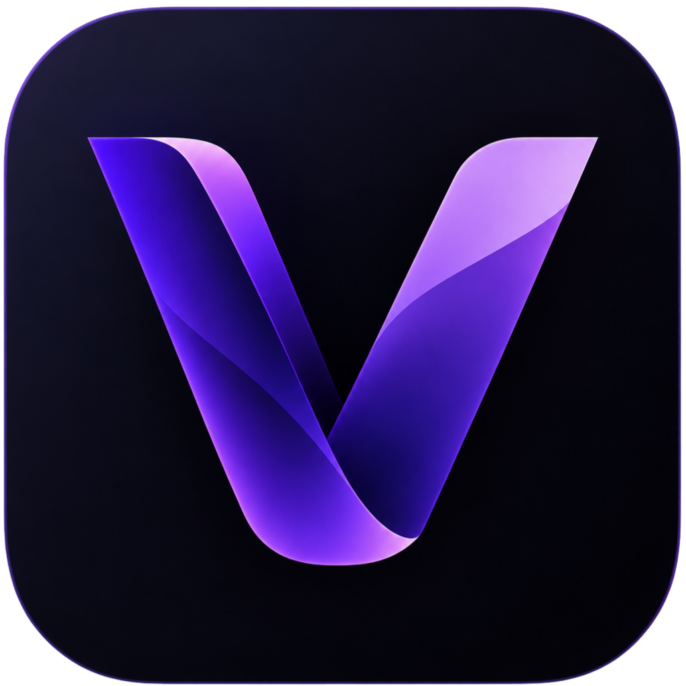
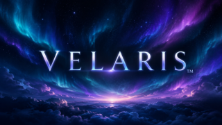

# Velaris

<p align="center">
  
  &nbsp;&nbsp;&nbsp;
  
</p>

Gemeinsames Repository für Velaris auf iOS, Android, Android TV / Google TV und als installierbare Web-App (PWA). Jellyfin dient als Medienserver; die Plattformen werden unabhängig versioniert.

## Stand der Zusammenführung

Die mobilen, TV- und Web-Anwendungen liegen in einem Monorepo, bleiben aber eigenständig baubar und versioniert. Gemeinsame Designvorgaben liegen unter `packages/velaris-design/`; es gibt derzeit keine einheitliche Runtime.

| Bereich | Pfad | Technik |
| --- | --- | --- |
| Smartphone (iOS / Android) | [apps/mobile](apps/mobile) | React Native / Expo / TypeScript |
| Web (iPhone / Desktop PWA) | [apps/web](apps/web) | HTML / CSS / JavaScript / Jellyfin API |\n| TV (Android TV / Google TV) | [apps/tv](apps/tv) | Kotlin / Media3 |
| Importnachweis und nächste Schritte | [docs/MIGRATION.md](docs/MIGRATION.md) | Quellstände, Umfang und Einschränkungen |

## Plattformversionen

| Plattform | Versionsstand im Quellcode |
| --- | --- |
| Velaris TV | **2.0.0** (`versionCode` 9) – Kategorie-Akzentpass |
| Velaris Smartphone | **2.0.0** (Expo, Android `versionCode` 9) – Kategorie-Akzentpass |
| Velaris Web | **2.0.1** (Kategorie-Akzente; Desktop-Navigation oben, iPhone unten) |

Die Versionsnummern sind unabhängig von einem signierten oder ausgerollten Release. Mobile benötigt einen neuen EAS-Build, Web ein neues Deployment und TV eine signierte APK für produktive Updates.

## Smartphone starten

Node.js 22.13+ verwenden. Alle Expo- und EAS-Befehle aus `apps/mobile` ausführen:

```bash
cd apps/mobile
npm ci
npm run start
```

Typprüfung: `npm run typecheck`.
Android-Test-APK über EAS: `npx eas-cli build --platform android --profile preview`.
Die vorhandene Expo-Projektzuordnung bleibt bestehen; dafür ist Zugriff auf das bestehende Expo-Projekt erforderlich.

## Velaris Web (PWA)

Die [Web-App](apps/web/README.md) läuft über Docker/Nginx auf ZimaOS und kann via Tailscale Serve im privaten Tailnet per HTTPS erreicht werden. iOS-Nutzer können sie in Safari zum Home-Bildschirm hinzufügen. Die tatsächliche Wiedergabe hängt von HTTPS, Jellyfin-Erreichbarkeit, Browser-Codecs und Transcoding ab. Versionsangaben oben sind Quellcode-Stände, keine Bestätigung für ein ausgerolltes Deployment.

## Velaris als ZimaOS-App

Für die App-Kachel mit Start/Stopp/Neustart in ZimaOS liegt eine eigene
[`x-casaos`-App-Definition](zimaos/velaris-compose.yaml) vor.
Die [Installations- und Migrationsanleitung](zimaos/README.md) erklärt, wie die
bestehende Web-2.0.0-Docker-Installation in die ZimaOS-App-Verwaltung
übernommen werden kann, ohne eine zweite Instanz auf Port 8088 zu starten.

**Hinweis:** Das Manifest setzt bereits lokal gebaute Docker-Images voraus.
Je nach ZimaOS-Installer kann stattdessen die Veröffentlichung versionierter
Registry-Images notwendig sein. Die App ist nicht automatisch auf ZimaOS
registriert und ein Git-Pull installiert keine App-Kachel.

## Velaris TV 2.0.0 (Kategorie-Farbpass)

Die native Android-TV-App in `apps/tv` ist auf **Version 2.0.0** (`versionCode 9`) gesetzt. Sie besitzt weiter dieselbe Android-Anwendungs-ID `com.novarion.velaristv`; die Smartphone-App bleibt unabhängig versioniert.

Release-Härtung und Abnahmetests: [UI-Pass 10](docs/UI_POLISH_PASS_10.md). Eine offizielle Veröffentlichung setzt grüne CI-Läufe, eine auf dem Google TV getestete APK und die Signierung mit dem passenden Schlüssel voraus.

## TV bauen

In Android Studio den Ordner `apps/tv` öffnen oder mit JDK 17 und Gradle 9.6.0:

```bash
cd apps/tv
gradle :app:lintDebug :app:assembleDebug
```

APK: `apps/tv/app/build/outputs/apk/debug/app-debug.apk`.

## Velaris YouTube – in Entwicklung

Die experimentelle Jellyfin-YouTube-Integration wird aktuell in [Pull Request #29](https://github.com/Homiiboy/Velaris/pull/29) auf Branch `feat/velaris-youtube-scaffold` entwickelt. **Sie ist noch nicht auf `main` integriert oder auf dem ZimaOS-Server installiert.**

Geplant sind direktes Abspielen von YouTube-Videos sowie optionales Archivieren mit Thumbnails und Metadaten. Die Grundstruktur umfasst:

- `services/velaris-youtube-plugin/`: Jellyfin-Plugin (C#/.NET 9; Kompatibilität mit der installierten Jellyfin-Version noch zu prüfen).
- `services/velaris-youtube-sidecar/`: Docker-basierter yt-dlp/FFmpeg-Dienst mit authentifizierter Metadaten- und Archiv-API.
- `services/README-YOUTUBE.md`: Entwicklungs- und Installationshinweise (auf dem Feature-Branch).

Direktes Streaming **innerhalb von Jellyfin/Velaris**, Kanalabonnements, Bibliothekssynchronisierung und automatische Downloads sind noch nicht implementiert. Das Plugin übernimmt keinen fremden Quellcode. Vor der Installation müssen Jellyfin-Version, Container-Netzwerk und Zugriffsrechte verifiziert werden.

### Kategorie-Farbkonzept (Web, TV und Smartphone)

Die Startseite behält Velaris Violet, während die Film-Kategorie Grün erhält. Die Kategorie-Akzentfarben sind zentral in [`packages/velaris-design/brand.json`](packages/velaris-design/brand.json) unter `categoryAccents` definiert. Mit UI-Pass V2.0.0 sind die Kategorie-Akzente in den Navigations-/Theme-Grundlagen der drei Apps umgesetzt; die Hintergründe bleiben im dunklen Velaris-Design.

| Kategorie | Farbe | Hex |
| --- | --- | --- |
| Startseite | Velaris Violet | `#7C5CFC` |
| Filme | Grün | `#46D369` |
| Serien | Eisblau | `#7DD3FC` |
| Anime | Orange | `#FF8A00` |
| Anime Filme | Gelb | `#FFD43B` |
| YouTube | YouTube-Rot | `#FF0033` |

Die jeweilige Akzentfarbe wird für aktive Navigation, ausgewählte Buttons, Fokusrahmen und Fortschrittsanzeigen eingesetzt. Standardtexte bleiben kontrastreich, damit besonders Gelb und Eisblau gut lesbar sind. **Bei YouTube gehört die rote UI-Akzentfarbe zur geplanten Velaris-Integration; sie bedeutet nicht, dass die YouTube-Bedienoberfläche bereits verfügbar ist.**

### UI-Pass V2.0.0 – kategorieabhängige Akzente

- **Startseite:** Violett (`#7C5CFC`), **Filme:** Grün (`#46D369`), **Serien:** Eisblau (`#7DD3FC`), **Anime:** Orange (`#FF8A00`), **Anime Filme:** Gelb (`#FFD43B`).
- **YouTube:** Rot (`#FF0033`) als vorbereiteter Token; eine YouTube-Kategorie ist noch nicht veröffentlicht.
- **Schwarz bleibt die Grundfarbe** (`#08080D`), auch bei Kategorie-Wechseln.
- Web: aktiver Menübereich steuert `--accent`; PWA-Cache und Versionskennung 2.0.0.
- Smartphone: Kategorie-Akzent aus dem aktuellen Expo-Router-Pfad, inklusive Tab-Leiste und Bibliothekskopf.
- TV: Kategorie-Akzent aus gemeinsamem `brand.json`, inklusive Navigationsfokus. Helle Akzente bekommen dunklere Beschriftung für Kontrast.
- Nicht zugeordnete Bereiche behalten das vorhandene neutrale/profilbezogene Theme. Der Pass ändert keine Jellyfin-Daten oder Medien.
- **Build-Status:** Quellcodeänderungen sind noch nicht per Android/TV/Browser-Gerätetests abgenommen; kein Deployment. Die Plattformversionen werden unabhängig weitergeführt.

### YouTube-Roadmap

Die Versionsstände beschreiben geplante Entwicklungsmeilensteine und keine fertigen Releases. Ein Meilenstein gilt erst nach erfolgreichem Test auf der vorgesehenen Jellyfin-Version als abgeschlossen.

| Version | Schwerpunkt | Status |
| --- | --- | --- |
| **V0.1.0** | Plugin-Grundstruktur (C#), yt-dlp/FFmpeg-Sidecar, Docker Compose, geschützte Metadaten- und manuelle Download-API | 🟡 Grundstruktur im [Entwicklungsbranch](https://github.com/Homiiboy/Velaris/tree/feat/velaris-youtube-scaffold), Build/Integration ungetestet |
| **V0.2.0** | YouTube-Videos direkt über Jellyfin streamen; kompatible Videoformate, Thumbnails, Titel und Beschreibungen | ⬜ Geplant |
| **V0.3.0** | Videos gezielt herunterladen, lokal mit Thumbnail/Metadaten ablegen und als Jellyfin-Medien einlesen | ⬜ Geplant |
| **V0.4.0** | Kanäle und Playlists verwalten, neue Videos synchronisieren, Download-Warteschlange und automatische Aktualisierung | ⬜ Geplant |
| **V0.5.0** | Wiedergabefortschritt/Gesehen-Status, Deduplizierung, Fehlerbehandlung und Berechtigungen | ⬜ Geplant |
| **V1.0.0** | Stabilitäts- und Gerätetests, dokumentierte ZimaOS-Installation und Integration in Velaris Web, TV und Smartphone (YouTube-Rot) | ⬜ Geplant |

**Nächste konkrete Schritte:** Jellyfin-Version auf ZimaOS verifizieren, Plugin-Build und Sidecar lokal testen, sichere Plugin-zu-Sidecar-Kommunikation herstellen und danach die Streaming-Integration entwickeln. Downloads sollen standardmäßig manuell ausgelöst werden, damit Speicherplatz kontrollierbar bleibt.

**GitHub Actions:** Der YouTube-Build wird nur manuell über `workflow_dispatch` gestartet; keine automatischen Builds bei Push oder Pull Requests.

## GitHub Actions

Die aktiven Workflows liegen zentral in `.github/workflows`:

- **Android TV CI**: TV-Lint und Debug-APK bei TV-Änderungen oder manuell.
- **Build unsigned iOS IPA**: manueller Build; die IPA ist unsigniert und muss vor einer Geräteinstallation signiert werden.
- **Generate package-lock**: manuelle Aktualisierung des Smartphone-Lockfiles.
- **Velaris YouTube scaffold** (derzeit Feature-Branch): ausschließlich manueller Start per `workflow_dispatch`, keine Push- oder Pull-Request-Builds.

Arbeitsverzeichnisse, npm-Cache und Artefaktpfade sind an die neue Struktur angepasst. Ein lokaler Android-Smartphone-Workflow war im Ursprungsrepository nicht vorhanden; dafür bestehen die EAS-Buildprofile.

## App-Identität

- Smartphone Android / iOS: `at.velaris.app`
- Android TV: `com.novarion.velaristv`
- Bestehende Versionen, Icons, Avatare und EAS-Projekt-ID bleiben erhalten.
- Signierschlüssel, GitHub-Secrets, Expo-Zugriffsrechte und frühere Build-Artefakte sind keine Quelldateien und werden durch diesen Import nicht übertragen. Die bestehende Signierung ist für Updates vorhandener Installationen erforderlich.

Die README-Dateien in den App-Ordnern dokumentieren den übernommenen Stand; ihre früheren Fertigmeldungen sind keine erneute Gerätevalidierung.

## Gemeinsame Struktur und Designsystem (Unified Experience)

```text
Velaris/
├── apps/mobile/               # iOS + Android (Expo / React Native)
├── apps/web/                  # installierbare iPhone-PWA und Web-Player\n├── apps/tv/                   # Android TV / Google TV (Kotlin / Media3)
├── packages/velaris-design/   # einheitliche Farben, Navigation, Profile und Reihen
├── assets/                    # zentrale App-Icons, Banner, Avatare
└── scripts/                   # Asset-Synchronisation und Konsistenztests
```

**Wichtig:** Alle Geräte nutzen dieselben Designvorgaben und echten Jellyfin-Konten.
Die mobile und die TV-Oberfläche sind gerätegerecht ausgelegt: Touch-Bedienung,
Cast und Downloads auf Smartphones, D-Pad-Navigation und Media3 auf dem TV.
Es gibt bewusst noch zwei native UI-Runtimes; der gemeinsame Brand-Vertrag liegt
in [packages/velaris-design/brand.json](packages/velaris-design/brand.json).

### Assets vereinheitlichen

Neue/ersetzte Bilder in `assets/` ablegen, danach im Repo-Stamm ausführen:

```bash
node scripts/sync-assets.cjs
node scripts/check-unified.cjs
```

Bei Änderungen auf GitHub ohne lokales Checkout müssen die App-Kopien
ebenfalls mit aktualisiert werden. Die CI meldet Abweichungen.

### Profile und Synchronisation

- Auf Handy und TV bis zu **5 echte Jellyfin-Benutzerkonten** (lokale Anmeldungen).
- Profilwahl beim Start; Favoriten, Verlauf und Weiterschauen kommen je Benutzer
  aus Jellyfin und sind damit geräteübergreifend synchronisiert.
- Vorhandene TV-Scheinprofile ohne Jellyfin-Anmeldung können keinen eigenen
  Fortschritt besitzen. Beim Umstieg bleibt das authentifizierte Konto erhalten;
  weitere Personen müssen sich mit eigenen Jellyfin-Konten anmelden.
- Geräte-eigene Einstellungen, heruntergeladene Medien und lokal gewählte
  Profilbilder werden **nicht** über Jellyfin synchronisiert.

GitHub Actions können die gemeinsame Gestaltung und die mobile Typprüfung prüfen;
die separate TV-CI führt Lint und den APK-Build aus. Gerätespezifische
Funktionstests sind weiterhin notwendig.
